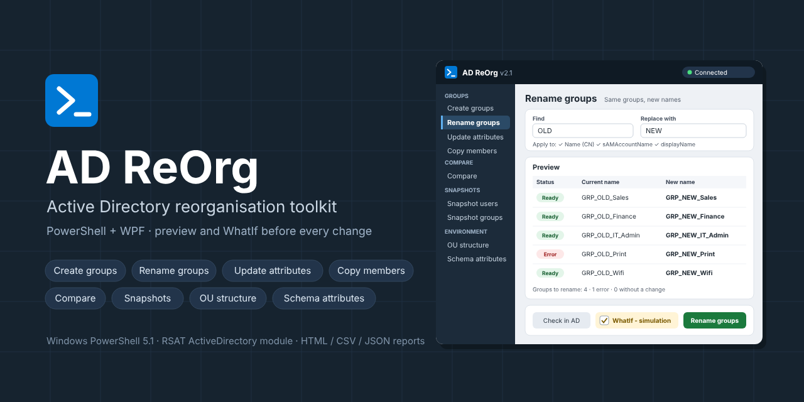

# AD ReOrg



Reorganising Active Directory: create, rename and update groups, copy members, compare objects, take snapshots of users and groups before and after a move, and copy an OU structure or schema attributes to a test environment.


---

## Contents

- [Tools](#tools)
- [Requirements](#requirements)
- [Getting started](#getting-started)
- [How a tool works](#how-a-tool-works)
- [Reports and logs](#reports-and-logs)
- [Configuration](#configuration)
- [Folder structure](#folder-structure)
- [Troubleshooting](#troubleshooting)

---

## Tools

### Groups

| Tool | What it does |
|---|---|
| **Create groups** | Creates new groups from existing ones in a target OU. Name rule (Find → Replace, prefix, suffix, sAM suffix), copies members by type (users, groups, computers), memberOf, description, notes and any attributes you list. Can nest the new group in the source, or copy members into existing groups only. |
| **Rename groups** | Renames existing groups in place: Name (CN), sAMAccountName, displayName and description. The SID, members, memberOf and permissions stay. *Check in AD* finds name conflicts before the run, and every live run can be renamed back with *Revert from report*. |
| **Update attributes** | Find → Replace of a text in any attribute. Check one group to see all its attributes, or many groups / whole OUs for a bulk update. Multi-valued attributes (e.g. `url`) get the new value added or replaced. |
| **Copy members** | Copies the members of one group into another. Click the source, then the target. Existing members are kept. |

### Compare

| Tool | What it does |
|---|---|
| **Compare groups / users** | Two groups or two users side by side, every attribute, differences in red. Export the comparison to HTML, CSV or JSON. Read-only. |

### Snapshots

| Tool | What it does |
|---|---|
| **Snapshot users** | 1. Export users with all attributes and group memberships (before and after a move). 2. Compare two exports: what changed per user, including lost and gained groups, with an SVG diagram. 3. Restore lost groups: add users back to the groups they lost. |
| **Snapshot groups** | Export the selected groups: OU, members, memberOf and an optional extra attribute. |

### Environment

| Tool | What it does |
|---|---|
| **OU structure** | 1. Export an OU and all its sub-OUs (in the source domain, read-only). 2. Create the same structure in another domain. Existing OUs are skipped. |
| **Schema attributes** | 1. Export the schema definitions of the attributes users have, including Exchange and custom attributes (in the source forest, read-only). 2. Create the missing attributes and classes in a test forest. **Schema changes are permanent** - see the warning in the tool. |

Where a tool needs an OU or a user, **Browse...** opens a tree of the domain (children load when a node is expanded) with a search box.

The two Environment tools run the scripts in [`tools/`](tools) unchanged in their own PowerShell process; their output is shown live in the tool. The scripts can also be run on their own from the command line - see [`tools/ou-structure/README.md`](tools/ou-structure/README.md) and [`tools/schema-attributes/README.md`](tools/schema-attributes/README.md).

---

## Requirements

- Windows with **Windows PowerShell 5.1** (WPF needs a Windows desktop session)
- The **ActiveDirectory** PowerShell module (RSAT: *Active Directory Domain Services and Lightweight Directory Services Tools*)
- Read access to AD for the read-only tools, and the matching rights for the tools that write:
  - create / rename / update groups and members in the OUs you work in
  - create OUs in the target domain (OU structure, step 2)
  - membership in **Schema Admins** in the target forest (Schema attributes, step 2)

---

## Getting started

1. Download the repository (Code → Download ZIP) and unzip it, for example to `C:\Tools\AD-ReOrg`.
2. Open **Windows PowerShell** and start the application:

   ```powershell
   cd C:\Tools\AD-ReOrg
   powershell.exe -STA -ExecutionPolicy Bypass -File .\AD-ReOrg.ps1
   ```

   The files are unblocked automatically at start, so a downloaded ZIP works without extra steps.
3. Check **Root** in the top bar (the domain root is filled in automatically) and click **Connect & load AD**.
4. Pick a tool in the sidebar. The **(i)** button next to the tool name explains how it works.

---

## Folder structure

```
AD-ReOrg/
├── AD-ReOrg.ps1                   start the application here
├── asset/
│   ├── xaml/MainWindow.xaml       the window (WPF)
│   └── logo/logo.png              optional logo for the HTML reports
├── functions/function/            the application's functions, one file per tool or area
│   ├── Modules.ps1                assemblies, ActiveDirectory module, grid row types
│   ├── Config.ps1                 reads config.json
│   ├── Ui-Common.ps1              status, log, messages, shared UI functions
│   ├── Report.ps1                 HTML / CSV / JSON reports
│   ├── Tree.ps1                   selection trees, connect and load AD
│   ├── Groups.ps1                 Create groups
│   ├── Rename.ps1                 Rename groups
│   ├── UrlMod.ps1                 Update attributes
│   ├── CopyMembers.ps1            Copy members
│   ├── Compare.ps1                Compare groups / users
│   ├── Snapshot.ps1               Snapshot users (export, compare)
│   ├── Restore.ps1                Snapshot users (restore lost groups)
│   ├── Analyse.ps1                Snapshot groups
│   ├── Environment.ps1            OU structure, Schema attributes
│   └── Show-MainWindow.ps1        loads the window and connects the controls
├── settings/config/
│   ├── config.json                settings
│   └── version.json               name and version
├── tools/                         stand-alone scripts used by the Environment tools
│   ├── Invoke-ToolScript.ps1      starts a script in its own PowerShell process
│   ├── ou-structure/              Export-OUStructure.ps1, Import-OUStructure.ps1
│   └── schema-attributes/         Export-SchemaAttributes.ps1, Import-SchemaAttributes.ps1
├── githubRepoContentDeleteIfYouWant/IMG/   images for this README
├── files/                         reports (created when needed, not in git)
└── logs/                          logs (created when needed, not in git)
```


